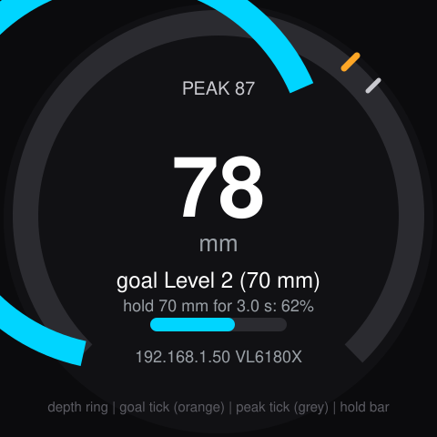

# DTT-Trainer

A deepthroat trainer with a live depth readout, built on the
[LilyGo T-RGB](https://www.lilygo.cc/products/t-rgb) 2.1 inch round display board
(ESP32-S3R8) and a **VL6180X** time-of-flight sensor.

The trainer in the shops is a passive board with a dildo on it: the depth is a
matter of guesswork. This one measures it. A time-of-flight sensor watches the
distance in front of the board, the firmware turns that distance into a depth in
millimetres, and the round panel shows it as a ring gauge with a peak marker, a
goal marker and a hold timer. Sessions are counted (time, peak, average depth,
holds), levels 1 to 3 can be selected or climbed automatically, and everything can
be driven and configured from a web browser over WiFi.

The firmware is a [PlatformIO](https://platformio.org/) project built on
[ESP32-SvelteKit](https://github.com/theelims/ESP32-sveltekit) (REST API,
WebSocket events, an embedded SvelteKit front end and a WiFi onboarding that puts
the device in access point mode on the first start).

<p align="center">

</p>

## Contents

- [Hardware](#hardware)
- [Wiring](#wiring)
- [First flash: the web flasher](#first-flash-the-web-flasher)
- [Every flash after that: the network](#every-flash-after-that-the-network)
- [WiFi range](#wifi-range)
- [Build from source](#build-from-source)
- [Using it](#using-it)
- [Calibration](#calibration)
- [API](#api)
- [Host tests](#host-tests)
- [Safety, hygiene and privacy](#safety-hygiene-and-privacy)
- [Roadmap](#roadmap)
- [Credits and license](#credits-and-license)

## Hardware

| Part | Detail |
| --- | --- |
| Board | LilyGo T-RGB 2.1 inch full circle: ESP32-S3R8, 16 MB flash, 8 MB OPI PSRAM, ST7701S 480x480 RGB panel, CST820 touch, XL9535 I/O expander |
| Sensor | VL6180X time-of-flight distance sensor breakout (0x29 on I2C), 3.3 V |
| Power | USB-C, or the on-board battery connector (the panel shows nothing about the cell; the web UI reports it) |
| Optional | 3D printed bracket to hold the sensor at the reference plane (see [Roadmap](#roadmap)) |

A **T-RGB 2.8 inch** board also works: set `-D TRAINER_PANEL_2_8_INCH=1` in
`platformio.ini` (only the panel init sequence differs). The 2.1 inch *half
circle* board uses a different touch controller (FT3267) and a different panel
init; it is not supported yet.

### Which sensor, exactly

Both parts are sold under almost the same name, and both answer at I2C address
0x29:

- **VL6180X** (model id `0xB4`) &mdash; the current part, ~0 to 200 mm, the one to
  use. The firmware uses the Adafruit driver for it, which writes the tuning
  registers ST recommends.
- **VL6180** without the X (model id `0xB3`) &mdash; the older part, shorter range.
  The firmware falls back to plain register access, so it does measure, but its
  accuracy is worse and it is not what this project is built for.

The firmware reads the model id before anything else and reports it: on the
serial port, on the panel footer and on the *Sensor and board* card of the web
UI. So there is no need to guess what is on the board.

## Wiring

The T-RGB has **no free GPIO** and one I2C bus, shared by the touch controller and
the XL9535 expander, brought out on the I2C connector. The sensor goes on that
same bus:

| Sensor | Board | Note |
| --- | --- | --- |
| VIN / 3V3 | 3V3 | the breakout and the expander are the only devices on the bus that tolerate 3.3 V; do not feed the sensor from 5 V |
| GND | GND | |
| SDA | GPIO 8 | shared with the touch controller |
| SCL | GPIO 48 | shared with the touch controller |
| (no other pin) | | the sensor has no interrupt line in this design |

There is nothing to configure: the address 0x29 does not collide with the touch
controller (0x15) or the expander (0x20). The firmware polls the sensor from one
task together with the touch controller, because the Arduino `Wire` library has no
locking and two tasks on one bus corrupt each other's transactions.

Resolution: the sensor reports whole millimetres, one sample per 25 ms, and the
firmware smooths the value with a filter whose time constant is a setting
(default 0.20 s).

### Mounting

The sensor must look along the axis the trainer works on, and its reference plane
is where the depth counts as zero. A sensible mount:

1. Put the sensor next to or just below the base of the dildo, facing outward,
   with nothing between it and the body.
2. Keep the sensor **at least 20 mm** away from the reference plane: below that,
   the optics and the near-field of the part make the reading unreliable.
3. Aim it slightly upwards or forwards so it sees the body and not the base plate
   or a hand that steadies the device.
4. Seal the sensor window against moisture with a clear cover (a piece of
   adhesive film is enough). The sensor is not waterproof and neither is the
   board.

Then calibrate, see [Calibration](#calibration).

## First flash: the web flasher

The first time, the board is programmed over USB from a browser. Nothing needs to
be installed.

1. Build the firmware, or take the merged image from a release:
   `build/merged/DTT-Trainer_t-rgb_0-1-0_webflash.bin`
2. Open <https://espressif.github.io/esptool-js/> (or any other ESP Web Tools
   page) in Chrome, Edge or Opera.
3. Connect the board with a USB-C cable, press **Connect** and pick the serial
   port (on Linux `/dev/ttyACM0`, on Windows a `COM` port).
4. Select the `..._webflash.bin` file and press **Program**.
5. If the port never appears, put the board in download mode: hold **BOOT**, tap
   **RST**, release **RST**, then release **BOOT**.

After the flash the board restarts and has no WiFi credentials, so it comes up as
an access point:

| | |
| --- | --- |
| Network | `DTT-Trainer-<id>` |
| Password | `dtt-trainer` |
| Address | <http://192.168.4.1> |
| Login | `admin` / `admin` |

Join that network, open the address, log in, and set the WiFi credentials on
**WiFi → WiFi Station**. The device then joins the network and is reachable at

```
http://dtt-trainer-<id>.local        # mDNS, when the network resolves .local
http://<the address it got>
```

The status bar of the web UI shows the address, and so does the footer line on the
panel.

**Change the admin password** on the *Users* page before the device is left in a
network that other people use.

## Every flash after that: the network

With `FT_UPLOAD_FIRMWARE=1` the device updates itself over HTTP; there is no
espota and no ArduinoOTA in this firmware.

From the browser: **System → Update**, choose
`build/release/DTT-Trainer_t-rgb_0-1-0.bin`, upload. The device reports progress
and reboots by itself.

From the command line:

```sh
scripts/ota-upload.py --device <ip> build/release/DTT-Trainer_t-rgb_0-1-0.bin
scripts/ota-upload.py --device <ip> --check      # login and report the running build only
```

The image must fit the free application slot, otherwise the device refuses it.
`build/release/` also holds the same image with an `.md5` next to it.

If a flash or an update *erases* the settings, the device comes up in access point
mode again and is only reachable at <http://192.168.4.1>. That is expected, not a
fault.

## WiFi range

The radio of this board is its weakest part: a small printed antenna on a 480x480
display board. Software cannot put an antenna back, but four settings decide how
much of the link budget is used, and this firmware sets all four:

| Setting | Value | Why |
| --- | --- | --- |
| Country code | `DE` (change with `-D TRAINER_WIFI_COUNTRY=".."`) | An ESP32 without one runs as country `01`, the worldwide safe set, which holds the lowest common denominator of every regulation: less power, fewer channels |
| Transmit power | 19.5 dBm, the radio's ceiling | Stated explicitly, so no default can leave it lower |
| Channel width | HT20 | HT40 doubles the occupied spectrum for throughput; this device sends a few hundred bytes at a time, so the link margin is worth more |
| Modem sleep | off | The radio wakes on every beacon instead of on the access point's DTIM, which is a much shorter round trip at the edge of a network |

The framework's join logic also ignores every network weaker than
`FACTORY_WIFI_RSSI_THRESHOLD`. That value is **-90 dBm here** instead of the
upstream -80: at -80 a network that a laptop calls "two bars" is simply not in the
candidate list, and the device falls back to its own access point instead of
joining.

### Read the numbers, do not guess

Twelve seconds after boot the firmware writes one line to the serial port. When
the device is connected:

```
[wifi] country DE ok, tx power 19.5 dBm ok, HT20 ok
[wifi] connected to "homie-2.4", -63 dBm, channel 6, IP 192.168.1.50
```

When it is not, it scans and lists what the radio can hear at all:

```
[wifi] not connected. 7 network(s) in range:
[wifi]    -51 dBm  channel  1  FritzBox7590
[wifi]    -68 dBm  channel 11  homie-2.4
[wifi]    -88 dBm  channel  6  Nachbar-WLAN
```

| Signal | Meaning |
| --- | --- |
| -50 dBm and better | excellent, anything works |
| -60 to -70 dBm | good, a solid link |
| -70 to -80 dBm | usable, occasional reconnects |
| -80 to -90 dBm | marginal: JSON goes through, the UI feels slow, expect drops |
| below -90 dBm | not a network any more |

The same number is in the panel footer next to the IP address, and in the web UI
status bar.

### What the scan tells you

- **The home network does not appear at all.** The ESP32 has **no 5 GHz radio**.
  A 5 GHz-only SSID is invisible to it, and no firmware can change that. Join the
  2.4 GHz SSID of the router (most have both), or enable 2.4 GHz.
- **It appears at -85 dBm or worse.** That is distance and walls, not firmware.
  Move the device, or put a cheap 2.4 GHz repeater between the router and the
  trainer. A repeater fixed exactly this symptom on other LilyGo S3 boards.
- **It appears at a good level but the join fails.** Check the password and the
  security mode (WPA2-PSK, or WPA2/WPA3 mixed — the safe choices for an ESP32), and
  that the router does not block new clients or use a hidden SSID.
- **Only channels 12 and 13 are usable nearby.** Set the country code to your
  country so the radio may transmit there.

Metal, a large water surface and the far side of a wall all cost more than any
setting in this table. The signal strength in the footer is the honest measure of
what is left.

One behaviour of this board family is worth knowing and is not a fault: while the
firmware is written to flash the picture can shift or freeze for a moment, because
the panel reads its picture out of PSRAM and a flash erase stops that memory.

## Build from source

```sh
pio run -e t-rgb            # firmware + front end, ~4 minutes the first time
pio run -e t-rgb -t size    # flash and RAM budget
pio run -e t-rgb -t upload  # over USB
pio device list             # serial ports
```

Artifacts of a successful build:

| File | Use |
| --- | --- |
| `build/merged/DTT-Trainer_t-rgb_0-1-0_webflash.bin` | ESP Web Tools, the whole device in one file |
| `build/release/DTT-Trainer_t-rgb_0-1-0.bin` (+ `.md5`) | OTA from the browser or with `scripts/ota-upload.py` |
| `lib/framework/WWWData.h` | the gzipped front end, embedded in the binary |

The front end is rebuilt by `scripts/build_interface.py` when a file under
`interface/src` is newer than `lib/framework/WWWData.h`. `npm` and `node` must be
on `PATH`.

## Using it

The panel is the point of the device; the web UI has the same readout plus the
configuration.

### The ring

| Element | Meaning |
| --- | --- |
| Ring, filled from the lower left clockwise | depth as a fraction of the full scale (`max_depth_mm`) |
| Cyan fill | free play, or a goal that is not reached |
| Green fill | the goal is held right now |
| Orange tick | the goal of the selected level |
| Grey tick | the peak of this session |
| Big number | depth in the selected unit |
| Second line | the goal, or free play and the level reached |
| Bar under the number | progress of the hold at the goal |
| Footer | the device address (or `AP 192.168.4.1`) and the sensor it found |

### Touch

| Gesture | Effect |
| --- | --- |
| Tap | start a session. A tap during a session ends it and stores its totals |
| Long press (1.5 s) | set the zero reference at the distance in front of the sensor |

The touch controller (CST820) is driven by this project's own driver: it is reset
through the XL9535 expander, because the board has no free pin for it. If the web
UI says the touch is *not found*, the panel still works; use the UI.

### Web UI

**Trainer** carries the live ring, the session buttons (*Start session*, *Stop
session*, *Zero here*, *Clear peak*), the goal selector and the hold progress.
Below it, three collapsed cards hold the calibration and the goals, the display
settings, and the sensor and board report.

* **Start session / Stop session** &mdash; the same as a tap. A session also ends
  by itself after `session_stop_s` (default 8 s) without a usable distance, so
  walking away closes the run.
* **Zero here** &mdash; writes the calibration so that the distance in front of the
  sensor means depth 0 right now. Do this with the trainer in the position it has
  when a session starts.
* **Clear peak** &mdash; forgets the peak marker of the current session.
* **Level to hold** &mdash; free play, or level 1 to 3. A goal turns the ring into a
  game: reach the depth of the level, hold it for `hold_seconds`, and the hold is
  counted. With *Climb a level after each completed hold* switched on, the goal
  moves up one level each time, up to level 3.

The session totals of the last run stay on the device until the next session ends.
Sessions are **not** written to flash; they live in RAM (see
[Roadmap](#roadmap)).

## Calibration

The sensor measures a distance; only you know what distance means depth 0. The
whole chain is:

```
depth = reference_mm - (range_mm + calibration_mm)      clamped to 0 .. max_depth_mm
```

Recipe:

1. Mount the device the way it will be used, and put the trainer where a session
   starts (the "rest" position).
2. Open the web UI, **Trainer** page. The *Distance* stat shows what the sensor
   sees right now.
3. Either set *Zero reference* to that distance, or press **Zero here**: that
   writes the calibration so the current distance is depth 0. Both end up in the
   same place; *Zero here* is quicker and self-correcting when the mount moves.
4. Check the scale with a ruler: bring a flat object to a known distance in front
   of the sensor and compare it with the *Distance* stat. A constant offset of a
   few millimetres is normal and is what *Calibration* is for. A reading that is
   *proportional but wrong* cannot be corrected here; that is the sensor's own
   accuracy and the reticle of the mount.
5. Set *Full scale* to the depth that should fill the ring, and set the three
   level depths to what you actually want to train.
6. Set *Smoothing*: 0 shows the raw sensor (jumpy, good for checking the mount),
   0.2 s is a good working value, above 0.5 s feels sluggish.

Settings live in `/config/trainerSettings.json` on the device and survive an OTA
update.

Two things that make a VL6180X read badly, in case the number looks wrong: a very
dark or very shiny surface in front of the sensor, and strong direct light (a
window, a lamp) shining at the same angle. Both are physics, not firmware.

## API

Everything the UI does is a plain HTTP call, so scripts and Home Assistant
automations can do it too. All endpoints need the JWT from
`POST /rest/signIn {"username": "admin", "password": "..."}`.

| Method | Path | Purpose |
| --- | --- | --- |
| GET | `/rest/trainerState` | the live state (distance, depth, session, board) |
| POST | `/rest/trainerState` | send a command; the reply is the new state |
| GET | `/rest/trainerSettings` | the persisted configuration |
| POST | `/rest/trainerSettings` | change configuration; one field is enough |
| GET | `/rest/features` | firmware version, enabled features (no login) |
| WS | `/ws/events?access_token=<jwt>` | subscribe to the event `trainer` |

Commands (`POST /rest/trainerState`):

```json
{"session_start": true}
{"session_stop": true}
{"zero": true}
{"reset_peak": true}
{"goal_level": 2}
{"display_on": false}
```

State and event fields of `/rest/trainerState` and the `trainer` event:

| Group | Fields |
| --- | --- |
| sensor | `sensor_present`, `sensor_model`, `sensor_model_id`, `sensor_mode`, `sensor_status`, `sensor_status_text`, `range_mm`, `sensor_good`, `sensor_bad` |
| trainer | `depth_mm`, `depth_raw_mm`, `peak_mm`, `gauge`, `level`, `level_name`, `goal_mm`, `in_zone`, `hold_complete`, `hold_progress`, `hold_seconds_held`, `hold_seconds_needed` |
| session | `session_active`, `session_seconds`, `session_avg_mm`, `session_deep_seconds`, `session_holds`, `last_session_*` |
| board | `display_present`, `display_frames`, `display_brightness`, `touch_present`, `touch_presses`, `battery_v`, `battery_known` |
| settings mirror | `units`, `reference_mm`, `auto_advance`, `notice` |

`range_mm` and `depth_mm` are `-1` when there is no usable sample. `notice` is a
one line message from the device ("zero set at 143 mm") that clears itself.

The event socket is the efficient way to follow a session: subscribe to `trainer`
and the device pushes the state when something really changed (at most 5 times per
second), instead of a client polling.

## Host tests

The rules that turn a distance into a depth, a depth into a level and a level into
a completed hold are in `src/trainer_math.h`, with no hardware dependency, and are
tested on a PC:

```sh
test/host/run.sh
# PASS: 49 checks, 0 failures
```

That is where a change to the maths should be checked first: it takes a second
instead of a build and a flash.

## Safety, hygiene and privacy

- The VL6180X is a **Class 1 laser** product: the emitter is safe to look at, as
  the class says. Do not take the optics apart and do not aim a bare light source
  into an eye.
- This device **never moves anything**. It measures and it displays. There is no
  motor, no actuator and no output that can drive one.
- The level display is a game, not a target to force. Hold and depth are meant to
  be increased slowly, and pain means stop, not continue.
- The board and the sensor are **not watertight**. Keep fluids away from them,
  cover the sensor window with a clear film, and clean the outside of the device
  with a damp cloth, not by running it under water. Put a cover over the sensor
  and the panel when the device is not in use and use a toy that can be cleaned
  separately from the electronics.
- **No camera, no microphone, no cloud.** The device has none of them. Sessions
  are counted in RAM and are gone after a power cycle. MQTT is off by default and
  no analytics are compiled in. The web UI is served by the device itself; it does
  not load anything from the internet.
- The web UI is protected by a login. Change the factory `admin`/`admin` password.

## Roadmap

Not built yet, in the order that seems most useful:

1. Store the last sessions in flash (`/config/trainerSessions.json`) so progress
   over days is visible, with a small history chart in the UI.
2. An MQTT bridge (`FT_MQTT=1`) that publishes the live state, for Home Assistant
   and for session notifications on a phone.
3. An OpenSCAD bracket for the sensor, so the reference plane is repeatable
   between devices instead of being calibrated on every mount.
4. Support for the 2.1 inch **half circle** board (FT3267 touch, another panel
   init sequence).
5. A per-sample CSV export over REST for training curves.

## Credits and license

This project is licensed under the **GNU Lesser General Public License v3.0**,
because it is built on ESP32-SvelteKit, which is LGPL-3.0 (see `LICENSE`).

| Component | License | What it does here |
| --- | --- | --- |
| [ESP32-SvelteKit](https://github.com/theelims/ESP32-sveltekit) | LGPL-3.0 | WiFi onboarding, REST, WebSocket, settings persistence, embedded front end |
| [GFX Library for Arduino](https://github.com/moononournation/Arduino_GFX) | MIT | the ST7701S RGB panel and the drawing primitives |
| [Adafruit_VL6180X](https://github.com/adafruit/Adafruit_VL6180X) | MIT | sensor detection and the VL6180X tuning registers |
| [Adafruit GFX](https://github.com/adafruit/Adafruit-GFX-Library) FreeSans fonts | BSD | the two fonts on the panel (`src/fonts/`, license next to them) |
| [LilyGo T-RGB examples](https://github.com/Xinyuan-LilyGO/LilyGo-T-RGB) | MIT | the panel init sequence, the pin map and the expander wiring this port is based on |

The trainer this project is named after is
[Research and Desire's Open Source Deepthroat Trainer](https://www.researchanddesire.com/products/deepthroat-trainer),
a passive board. This project is an independent, electronic take on the same idea
and shares no code or files with it.
